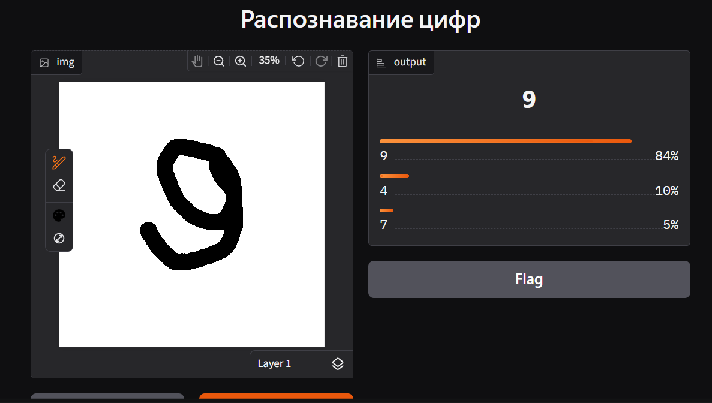

# УСТАНОВКА

```
pip install torch torchvision --index-url https://download.pytorch.org/whl/cpu
pip install gradio pillow numpy
```

# ЗАПУСК

```
python train.py
python app.py
```



# ОГРАНИЧЕНИЯ

- Только одиночные цифры: Модель обучена исключительно на цифрах от 0 до 9. Она не распознает многозначные числа, буквы, математические знаки или другие символы.

- Проблемы с центровкой и масштабом: Нейросеть ожидает, что цифра будет находиться примерно в центре картинки и занимать определенную площадь. Если нарисовать цифру слишком маленькой в углу или, наоборот, так, что она обрежется краями, точность предсказания сильно упадет.

- Только черно-белые изображения: Модель не умеет работать с цветными картинками или фотографиями с тенями и сложным фоном (например, фото цифры на бумаге со стола). Картинка должна быть бинаризована (черная цифра на белом фоне или наоборот).
